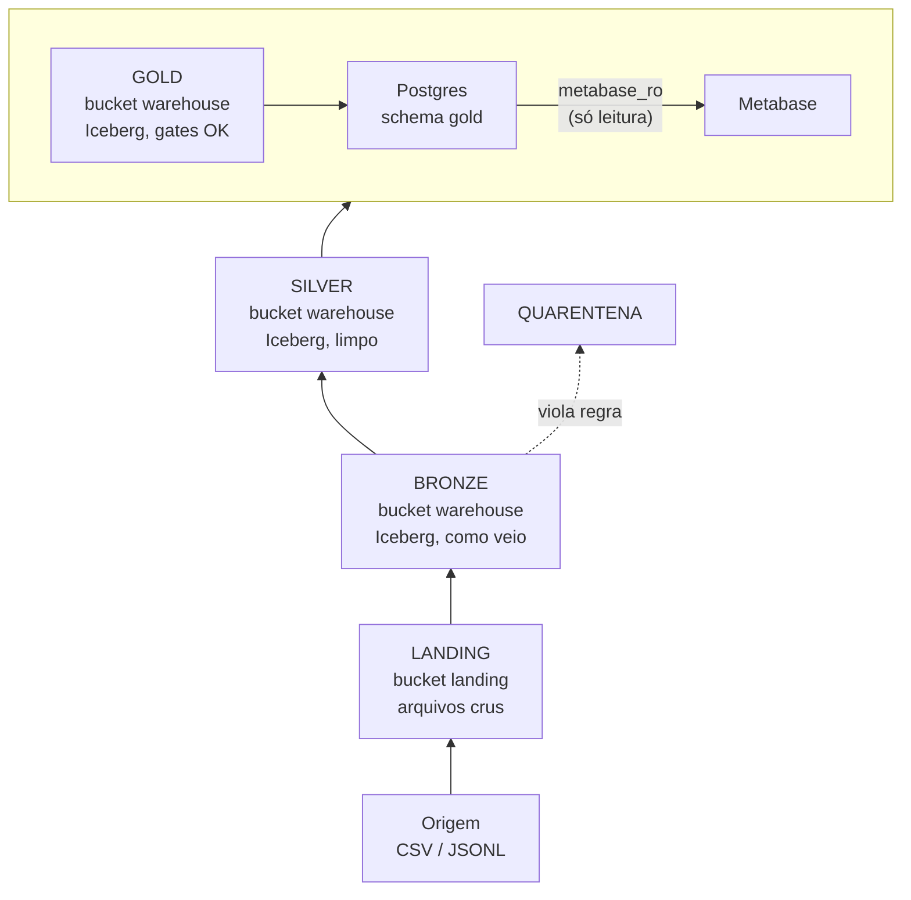
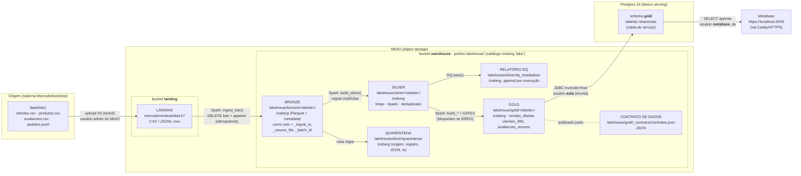
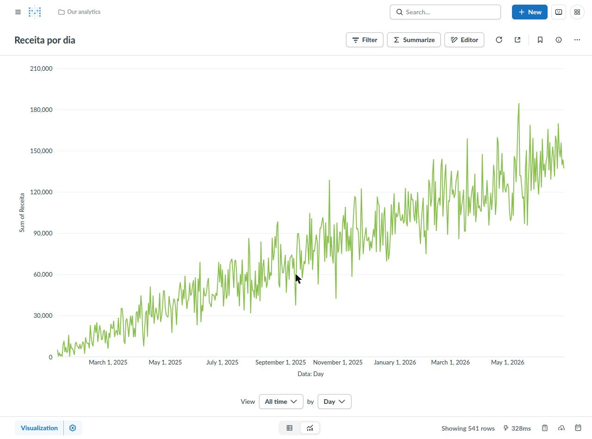
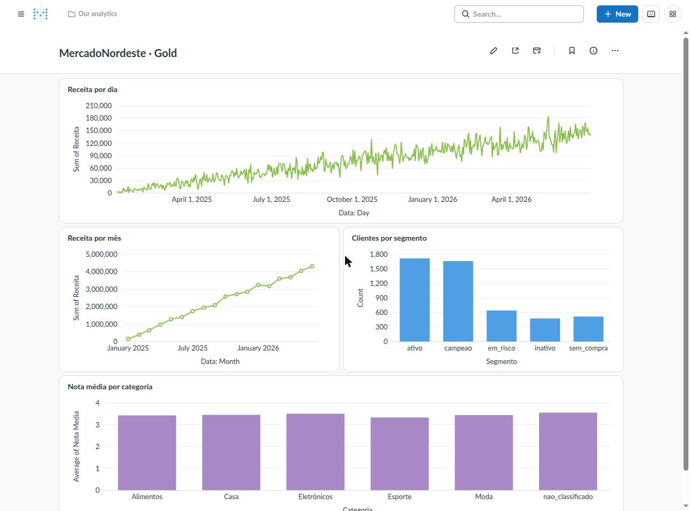

# Atividade · Arquitetura Medalhão (MinIO + Spark + Iceberg + Postgres + Metabase)

Versão usada: **Spark** (`notebooks/01_bronze.ipynb`, `02_silver.ipynb`, `03_gold.ipynb`) e o complemento
`notebooks/04_governanca_spark.ipynb`, que traz o contrato de dados, os gates, o nome mascarado, o versionamento
do bucket, o histórico do DQ e o usuário somente leitura do Metabase. O `03_gold` Spark original não tinha essas partes.

---

## PARTE 1 · Arquitetura

### Diagrama

> Os diagramas estão em Mermaid. Eles aparecem desenhados no GitHub, no VS Code e no <https://mermaid.live>, que também exporta para PNG/SVG. Arquivos separados: [diagrama_simplificado.mmd](diagrama_simplificado.mmd) e [diagrama_completo.mmd](diagrama_completo.mmd).

**Versão simplificada** (visão geral do fluxo):

**Versão completa** (com DQ, contrato e usuários de cada etapa):

### Quem escreve e quem só lê

| Etapa | Onde fica | Formato | Quem escreve | Quem só lê |
|---|---|---|---|---|
| Landing | bucket `landing`, `mercadonordeste/lote1/` | CSV e JSONL, como a origem enviou | sistema de origem (aqui, `admin` do MinIO via boto3) | job de ingestão (Spark) |
| Bronze | bucket `warehouse`, `lakehouse/bronze/<tabela>/` (particionada por `_batch_id`) | Iceberg (Parquet em `data/`, metadados em `metadata/`) | job Spark de ingestão (`admin`) | job da Silver, auditoria |
| Silver | `warehouse/lakehouse/silver/<tabela>/` | Iceberg | job Spark da Silver | job da Gold, analistas de dados |
| Quarentena | `warehouse/lakehouse/silver/quarentena/` | Iceberg (`origem`, `registro` em JSON, `_quarentena_ts`) | job Spark da Silver | time de dados / dono da origem (para corrigir na fonte) |
| Relatório DQ | `warehouse/lakehouse/silver/dq_resultados/` | Iceberg, **append** (1 snapshot por execução) | job de DQ | quem monitora o pipeline |
| Gold | `warehouse/lakehouse/gold/<tabela>/` | Iceberg (**fonte da verdade**) | job Spark da Gold, **só se os gates passarem** | job de publicação |
| Contrato | `warehouse/lakehouse/gold/_contratos/contratos.json` | JSON (grão, dono, chave, descrição de cada coluna) | job da Gold (junto com a publicação) | consumidores (BI, analistas, IA) |
| Serving | Postgres `serving`, schema `gold` | tabelas relacionais (cópia) | usuário de administração **`aula`** (JDBC, `TRUNCATE` + insert) | **`metabase_ro`**: só `USAGE` + `SELECT` |
| BI | Metabase | perguntas e dashboards | admin do Metabase cria as perguntas | usuários do negócio |

> Observação honesta: no laboratório, landing e warehouse usam a mesma credencial `admin` do MinIO. Em produção cada etapa teria a sua credencial: a origem só grava na landing, o job da Bronze só lê a landing, e assim por diante.

### Cada etapa em poucas palavras

**1. Landing (bucket `landing`)**
- *Entra:* os 4 arquivos do lote (`clientes.csv` 420.891 B, `produtos.csv` 9.044 B, `avaliacoes.csv` 529.223 B, `pedidos.jsonl` 7.571.082 B).
- *Sai:* os mesmos arquivos, intactos, em `mercadonordeste/lote1/`.
- *Regra principal:* **não se altera**. É a prova do que a origem enviou.

**2. Bronze (Iceberg em `warehouse/lakehouse/bronze`)**
- *Entra:* os arquivos da landing.
- *Sai:* `lake.bronze.clientes` (5.000), `produtos` (200), `pedidos` (30.150), `avaliacoes` (6.489), com `_ingest_ts`, `_source_file` e `_batch_id`.
- *Regra principal:* **guardar como veio**: sem limpar, sem deduplicar e sem tipar (`itens` continua lista de structs, CSVs como texto). Reexecutar o mesmo lote **não duplica**, porque a ingestão faz `DELETE WHERE _batch_id = 'lote1'` e depois o append.

**3. Silver (Iceberg em `warehouse/lakehouse/silver`)**
- *Entra:* toda a Bronze (todos os lotes).
- *Sai:* `clientes` 5.000, `produtos` 197, `pedidos` 29.960, `itens_pedido` 50.030, `avaliacoes` 6.464; `quarentena` 68; `dq_resultados`.
- *Regra principal:* toda transformação tem **regra explícita**, e o que viola a regra **vai para a quarentena** em vez de sumir. As regras: tipagem, e-mail inválido vira `NULL`, deduplicação pela versão mais recente, `preco/custo > 0`, cliente precisa existir, `nota` entre 1 e 5. Reconciliação: **entrada = silver + quarentena**.

**4. Gold (Iceberg em `warehouse/lakehouse/gold`)**
- *Entra:* a Silver.
- *Sai:* `vendas_diarias` (30.755 linhas, grão data × categoria × estado × canal), `clientes_360` (5.000, grão cliente, nome mascarado e sem e-mail), `avaliacoes_resumo` (112, grão mês × categoria) e o contrato em JSON.
- *Regra principal:* **só é publicada se passar nos gates** de grão, governança e reconciliação.

**5. Serving (Postgres, schema `gold`) e Metabase**
- *Entra:* as tabelas Gold do Iceberg.
- *Sai:* as mesmas 3 tabelas no Postgres, lidas pelo Metabase.
- *Regra principal:* o Postgres é **cópia**: a fonte da verdade é o Iceberg. A carga usa `TRUNCATE` para não quebrar painéis nem permissões, e o Metabase conecta com **`metabase_ro`** (só leitura).

---

## PARTE 2 · Evidências de que a arquitetura roda

Todas as saídas estão gravadas nos notebooks (executados). Resumo, com onde achar cada uma:

| Evidência pedida | Onde | Resultado |
|---|---|---|
| Listagem da landing | `01_bronze` célula 8; `04` seção 1 | 4 objetos em `mercadonordeste/lote1/` |
| Listagem do warehouse | `01_bronze` célula 16; `04` seção 1 (inventário por camada) | `lakehouse/bronze/pedidos/data/_batch_id=lote1/…parquet` + `metadata/v1.metadata.json`, `snap-…avro`, `…-m0.avro`, `version-hint.text` |
| Experimento da “pasta” | `01_bronze` célula 11 | `Prefixos: ['mercadonordeste/lote1/']`; depois do “renomear”: `['teste/b.txt']` (copy + delete) |
| Contagem por tabela | `04` seção 2 | bronze 5.000/200/30.150/6.489 · silver 5.000/197/29.960/50.030/6.464 · quarentena 68 · gold 30.129→30.755/5.000/112 |
| Idempotência | `01_bronze` célula 18 | `Linhas: 30150 -> 30150 \| idempotente: True`; objetos `5 -> 12` (data 1→2, metadata 4→10); arquivos na versão atual: **1** |
| Resumo da construção | `02_silver` célula 7 | `{'clientes': 5000, 'produtos': 197, 'pedidos': 29960, 'itens_pedido': 50030, 'avaliacoes': 6464, 'quarentena': 68}` |
| Quarentena por origem | `02_silver` célula 11 | `pedidos_cliente_orfao` 40 · `avaliacoes_nota_invalida` 25 · `produtos` 3 |
| Reconciliação | `02_silver` célula 9 | `pedidos : 30000 = 29960 (silver) + 40 (quarentena) -> True` |
| Relatório DQ + `dq_resultados` | `02_silver` célula 13; `04` seção 3 | 8 regras, 7 OK, 1 AVISO (`not_null email`: 270 falhas, 5,4%); com `DQ.save()` cada execução virou um snapshot novo (4 execuções guardadas) |
| Erro simulado + recuperação (Iceberg) | `02_silver` células 17–19 | `linhas: 50105 -> 43886 (sumiram 6219)`; `VERSION AS OF 6192292304794414773` = 50.105; após `rollback_to_snapshot`: **50.105** |
| Erro simulado + recuperação (bucket versionado) | `04` seção 4 | versão errada 43.886 / versão boa 50.105; `copy_object(VersionId=boa)` deixou 50.105 e 3 versões guardadas |
| Gates com todos OK | `04` seção 6.2 | **OK 17**, incluindo `receita Gold (40.817.199,93) = receita Silver (40.817.199,93)` |
| Gate bloqueando | `04` seções 6.1 e 6.2 | Gold original: **5 ERRO** (reconciliação, colunas sem contrato, `nome` = PII, categoria NULL); cópia com linha duplicada: `-> publicação BLOQUEADA` |
| Três tabelas publicadas + contrato | `04` seção 7 | `lake.gold.vendas_diarias` 30.755 · `clientes_360` 5.000 · `avaliacoes_resumo` 112; `s3://warehouse/lakehouse/gold/_contratos/contratos.json` |
| Gold no Postgres | `03_gold` célula 5; `04` seção 8 | contagens iguais no Postgres e no Iceberg (30.755 / 5.000 / 112) |
| Usuário somente leitura | `04` seção 8.1 | `metabase_ro`: SELECT **PERMITIDO**; INSERT, DELETE, TRUNCATE, CREATE e DROP **NEGADOS** |
| Pergunta de negócio | `04` seção 8.2 (mesma consulta do Metabase) | Receita por dia: 541 dias, total R$ 40.817.199,93; por mês, de R$ 150.828,98 (2025-01) a R$ 4.315.617,46 (2026-06) |

### Pergunta de negócio no Metabase

Conexão **"Gold (metabase_ro, somente leitura)"**: PostgreSQL, host `postgres`, banco `serving`, usuário **`metabase_ro`**, filtrando só o schema `gold`. O sync encontrou as 3 tabelas, e a `clientes_360` já aparece com `nome_mascarado` (sem `nome` e sem `email`).

**Receita por dia** (`gold.vendas_diarias`, soma de `receita` por `data` diária): 541 dias, de ~R$ 5 mil/dia no início de 2025 a ~R$ 140–180 mil/dia em junho de 2026.

**Dashboard "MercadoNordeste · Gold"**: receita por dia, receita por mês, clientes por segmento (ativo 1.713, campeão 1.656, em risco 640, sem compra 515, inativo 476) e nota média por categoria. Repare na categoria `nao_classificado`: são as avaliações dos 3 produtos em quarentena, que a Gold corrigida passou a mostrar em vez de deixar com categoria vazia.

---

## PARTE 3 · Perguntas

**Qual regra da Silver mandou mais registros para a quarentena e por quê?**
Foi a regra de **integridade referencial dos pedidos** (`pedidos_cliente_orfao`): **40 pedidos**, contra 25 avaliações com nota inválida e 3 produtos com preço negativo. Os 40 têm o mesmo `cliente_id = 999999`, que não existe em `silver.clientes`. Exemplos: `{"pedido_id":103054,"cliente_id":999999}` e `{"pedido_id":104139,"cliente_id":999999}`. É um valor “coringa”, típico de pedido de teste ou de cliente não identificado no sistema de origem. Esses pedidos levavam 75 itens, e é exatamente essa a diferença entre os itens feitos “na mão” (50.105) e os feitos pela função (50.030). Vale notar que os maiores “problemas” do dado não foram para a quarentena: os **150 pedidos duplicados** foram resolvidos pela deduplicação e os **270 e-mails inválidos** viraram `NULL` (o cliente continua válido).

**Se a reconciliação não fechasse, o que você investigaria primeiro?**
Primeiro, **os joins**, porque um `inner join` descarta linhas em silêncio. Foi exatamente o que o gate encontrou na Gold. A receita da `vendas_diarias` original era R$ 40.310.963,52, contra R$ 40.817.199,93 na Silver: faltavam R$ 506.236,41 e 1.282 unidades. A causa eram os 652 itens dos produtos 55, 114 e 173, que estavam na quarentena da Silver e sumiram no join com `silver.produtos`. Depois dos joins, olharia: (1) a **deduplicação** (critério de `row_number`, empates de `_ingest_ts`); (2) se **cada regra de rejeição grava na quarentena** (ex.: a Silver de clientes descarta `cliente_id` nulo sem gravar origem própria); (3) se a **contagem de entrada** é a certa (linhas ou ids distintos: 30.150 linhas contra 30.000 pedidos); (4) filtros de status e cast que viram `NULL`.

**Que dado pessoal existe e como foi tratado?**
- `nome` e `email` estão na Bronze e na Silver (`clientes`), mas nessas camadas o acesso é restrito ao time de dados.
- `email`: na Silver, e-mail inválido vira `NULL` (270 casos). Na Gold ele **não entra** (removido por minimização).
- `nome`: na Gold `clientes_360` é **mascarado** (`Aline Pereira` → `A**** P******`). Um gate impede publicar qualquer coluna chamada `nome`, `email`, `cpf` ou `telefone`. A Gold original do notebook 03 publicava o nome completo, e o gate a bloqueou.
- `cliente_id` é um pseudônimo: continua na Gold para análises, mas o acesso fica **restrito**. O Metabase lê só o schema `gold`, com o usuário `metabase_ro`, que não enxerga a Silver.
- Ponto de atenção: o histórico (snapshots do Iceberg e versões do bucket) **mantém dado pessoal antigo**. Para o direito ao esquecimento é preciso `expire_snapshots` e apagar cada `VersionId`, como foi demonstrado no notebook 04.

**O que mudaria com 1.000× mais dados?**
Pelo **catálogo**, antes de tudo. O Hadoop catalog depende de “rename” atômico, que o S3 não tem: com vários jobs escrevendo ao mesmo tempo, há risco de corromper o ponteiro de versão (`version-hint.text`). Ele seria trocado por um catálogo transacional (REST/Nessie/Glue/Hive). Depois viria o **processamento**: sair do `local[2]` com 2 GB para um cluster (Spark em Kubernetes/EMR/Databricks) e tornar a Silver **incremental** (`MERGE` só do lote novo), em vez de reconstruir toda a Bronze a cada execução. O **formato** (Parquet + Iceberg) já serve para essa escala. Faltaria ajustar o particionamento por data em vez de `_batch_id`, compactar arquivos pequenos e rodar `expire_snapshots`/`remove_orphan_files` periodicamente (a reexecução de um único lote já levou de 5 para 12 objetos). Também passaria a **orquestrar** com Airflow ou Dagster, guardaria segredos num cofre e usaria uma credencial por etapa.
